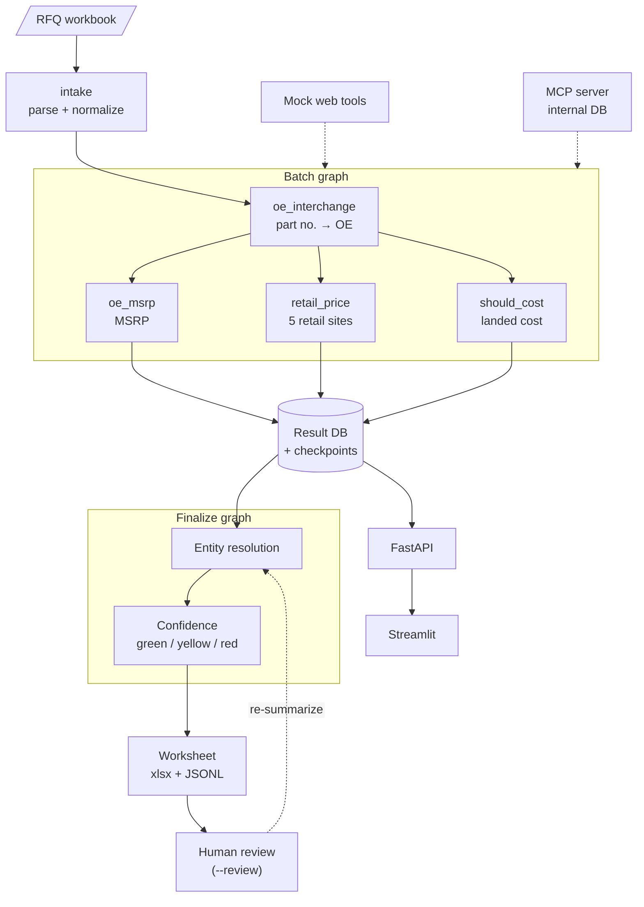

# RFQ-Agent

English | [简体中文](README.zh-CN.md)

An automated quoting pipeline for automotive aftermarket RFQs (requests for quotation), built with Python and LangGraph. A customer sends an Excel RFQ with hundreds to thousands of customer part numbers. For each one, the system finds the OE (original equipment) number, looks up the OE maker's list price (MSRP) and retail prices, estimates the should-cost, and writes a pricing worksheet colored by confidence for the pricing team to decide on.

This is currently a **project for learning and exchange**. It focuses on design questions such as splitting work across agents, stage contracts, entity resolution, batching and fault tolerance, confidence-based triage and human review, and it tests its confidence strategies with measurable evaluations. The plan is to grow it into a version that works with real enterprise data; if you are interested in that direction and would like to collaborate, please reach out through a GitHub issue.

- Every external data source (OEM catalog, interchange lookup, OE maker price pages, five retail sites, product spec pages) is a **mock**. The data comes from a synthetic data generator with ground truth; brands and vehicles are fictional, and no real website is scraped.
- The internal parts database is SQLite, accessed through an MCP server.
- The rates in `cost_model.yaml` are illustrative only and do not represent any real tariff or quote.

Tech stack: Python 3.11+, uv, LangGraph, LangChain chat models (DeepSeek by default; Anthropic, Qwen and a FakeLLM for tests are also supported), the official `mcp` SDK with `langchain-mcp-adapters`, Pydantic v2, SQLite, FastAPI, Streamlit, openpyxl, pytest.

The detailed spec ([RFQ-SPEC.md](RFQ-SPEC.md)), glossary ([GLOSSARY.md](GLOSSARY.md)) and per-phase decision records ([docs/plans/](docs/plans/)) are written in Chinese.

## Quick start

Install [uv](https://docs.astral.sh/uv/) first; uv provides the Python version pinned in `.python-version`. These three commands run the whole pipeline in fake mode, with no API key and no cost:

<!-- quickstart:begin -->
```bash
uv sync
uv run rfq data generate
RFQ_LLM_PROVIDER=fake uv run rfq run --input data/samples/rfq_sample_20.xlsx
```
<!-- quickstart:end -->

1. `uv sync` creates `.venv` and installs the dependencies.
2. `rfq data generate` builds the 200-row synthetic dataset `data/generated/n200_s42/` (internal database `internal.db`, the mock pages, ground truth) and prints the measured share of each difficulty. It also writes the 20-row sample `data/samples/rfq_sample_20.xlsx`, byte-identical to the file in the repository.
3. `rfq run` runs the full pipeline over the 20-row sample. `RFQ_LLM_PROVIDER=fake` makes every role use the FakeLLM, which extracts from page text with rules: deterministic and free, meant to exercise the pipeline, not to measure model accuracy.

Output of the third command (actually run in a fresh clone; paths shortened to relative ones):

```text
LLM calls: oe_interchange (fake/fake) expected ~60, upper bound 300
LLM calls: oe_msrp (fake/fake) expected ~20, upper bound 60
LLM calls: retail_price (fake/fake) expected ~20, upper bound 60
LLM calls: should_cost (fake/fake) expected ~20, upper bound 60
LLM calls: judge (fake/fake) expected ~20, upper bound 60
rows=20 strategy=evidence_plus_judge
run_id=run-20261013T052139Z-cc51d4  (resume with: rfq run --resume run-20261013T052139Z-cc51d4)
batches: completed 1
rows 20: green 11, yellow 5, red 4
LLM usage: calls=101 errors=0 input_tokens=35890 output_tokens=7515 cost_usd=0.0
worksheet: data/runs/run_run-20261013T052139Z-cc51d4.xlsx
rows: data/runs/run_run-20261013T052139Z-cc51d4.jsonl
row correct 20/20 (by band: green 11/11, yellow 5/5, red 4/4)
```

Outputs in `data/runs/`:

- `run_<run_id>.xlsx`: the pricing worksheet. One row per RFQ part number, the whole row colored by band (green / yellow / red). MSRP, reference retail price and landed cost sit side by side as the reference price range, followed by the confidence score, review reasons and a reasoning summary per stage. The second sheet is the run summary.
- `run_<run_id>.jsonl`: one complete result per row (the four agents' outputs, evidence, confidence signals).
- Runs, stage results and LLM calls are stored in the result database `data/rfq.db`, which the API and the dashboard read.

The last line, `row correct`, is a quick check of the fake results against the sample's ground truth; see `rfq eval` below for the full evaluation.

## Architecture



- Each of the four subagents is a standalone LangGraph subgraph with its own CLI subcommand and tests. The LLM only extracts facts from noisy page text; choosing numbers, building supersession chains, outlier detection, price selection and the cost formulas are deterministic code.
- The batch graph takes 100 rows per batch (configurable), one batch after another. Within a batch it fans out the three price / cost agents in parallel over the OE results, and a batch's results are written to the result database in one transaction. Checkpoints are per row and per agent, so after a killed process `--resume` only runs what was left.
- Entity resolution and confidence run over the whole table in the finalize graph, because many-to-one groups sharing an OE number usually span batches. The worksheet can be downloaded once finalizing is done; runs started with `--review` then review the red rows of the finalized results, and each decision goes back to entity resolution to re-summarize.
- Confidence has three switchable strategies (`evidence` / `evidence_plus_self` / `evidence_plus_judge`). The default is `evidence_plus_judge`; see [Evaluation results](#evaluation-results) for why.

## Configuration

Configuration lives in `config/`; API keys go only in `.env` (ignored by git).

Sections of `config/settings.yaml`:

| Section | What it controls | Keys most often changed |
|---|---|---|
| `llm` | Default provider / model, temperature, concurrency, prices (for cost tracking), per-role overrides, each provider's `base_url` and API key variable name | `provider`, `model`, `max_concurrency`, `pricing_per_million`, `roles.judge` |
| `pipeline` | Batch size, structured-output retries, retail outlier threshold, tolerance for internal vs external weights | `batch_size`, `retail_outlier_threshold` |
| `confidence` | Confidence strategy, band thresholds, self-assessment and judge parameters, evidence signal weights and values | `strategy`, `bands`, `judge_band`, `evidence.weights` |
| `storage` | Paths of the result database, checkpoint database and upload directory; run lease timing | `db_path`, `checkpoint_path` |
| `data` | Default dataset directory (read by the mock tools and the internal database) | `dataset_dir` |
| `tools` | Hits per mock search, near-miss decoy pages mixed in, fault injection (timeouts, empty results) | `max_decoys`, `faults` |

`config/cost_model.yaml` holds the rates of the should-cost and landed-cost formulas (illustrative values); the synthetic ground truth uses the same parameters.

`uv run rfq config show` prints the merged settings and the provider / model each role resolves to, and whether its API key is set (the key itself is never printed).

Environment variables:

| Variable | Effect |
|---|---|
| `RFQ_LLM_PROVIDER` | `fake` forces the FakeLLM for every role |
| `DEEPSEEK_API_KEY` / `ANTHROPIC_API_KEY` / `DASHSCOPE_API_KEY` | API keys for DeepSeek / Anthropic / Qwen (names set by `llm.providers.*.api_key_env`) |
| `RFQ_CONFIG_DIR` | Use another config directory (default `config/`) |
| `RFQ_SKIP_DOTENV` | `1` skips reading the project `.env` (used by tests) |
| `RFQ_API_URL` | API address used by the dashboard, default `http://127.0.0.1:8000` |

### Using a real LLM

The default configuration is DeepSeek (`deepseek-flash` for the agents, `deepseek-v4-pro` for the judge).

1. `cp .env.example .env` and fill in the key for your provider.
2. Add `--allow-real` to the command. Every command that calls an LLM (`rfq run`, `--resume`, `rerun-failed`, `rescore`, `rfq agent ...`, `rfq api serve`) first prints the provider / model and expected call count per role; without `--allow-real` it refuses before sending any request:

```text
$ uv run rfq run --input data/samples/rfq_sample_20.xlsx
LLM calls: oe_interchange (deepseek/deepseek-flash) expected ~60, upper bound 300
LLM calls: oe_msrp (deepseek/deepseek-flash) expected ~20, upper bound 60
LLM calls: retail_price (deepseek/deepseek-flash) expected ~20, upper bound 60
LLM calls: should_cost (deepseek/deepseek-flash) expected ~20, upper bound 60
LLM calls: judge (deepseek/deepseek-v4-pro) expected ~20, upper bound 60
rows=20 strategy=evidence_plus_judge
Real LLM provider for role 'oe_interchange' (deepseek), 'oe_msrp' (deepseek), 'retail_price' (deepseek), 'should_cost' (deepseek), 'judge' (deepseek); re-run with --allow-real to proceed.
```

Tokens, cost and latency of every call are recorded in the `llm_calls` table of the result database and summed up by `rfq runs show` and the evaluation report.

SQLite ≥ 3.51.2 is required (3.51.0 / 3.51.1 can deadlock when a connection is closed from another thread; the code warns when it detects them).

## Evaluation results

All numbers below come from experiments run with a real LLM (`deepseek-flash` for the agents) and recorded in `docs/plans/`; run ids and the full observations are in those files. Evaluation numbers in fake mode only show that the pipeline runs and mean nothing about accuracy.

### Three confidence strategies, 200 synthetic rows ([phase-10.md](docs/plans/phase-10.md), 2026-10-09)

One full run with `evidence`, then `rfq rescore` re-scores the same agent results with the other two strategies, so the differences come from the confidence strategy alone. Judge rules at the time: it reviewed only rows with an evidence score of 50–79, and agreement also raised the score.

| Strategy | LLM calls | Cost (this run) | Total (with agents) | Per 1k rows | Green / yellow / red | Row correct | Usable as is | ECE | AUROC |
|---|---|---|---|---|---|---|---|---|---|
| `evidence` | 864 | $0.453 | $0.453 | $2.27 | 115 / 49 / 36 | 100% | 82.0% | 0.209 | 1.000 |
| `evidence_plus_self` | 328 | $0.166 | $0.619 | $3.09 | 148 / 16 / 36 | 100% | 82.0% | 0.190 | 1.000 |
| `evidence_plus_judge` | 49 | $0.108 | $0.561 | $2.81 | 154 / 10 / 36 | 100% | 82.0% | 0.192 | 1.000 |

Every stage was correct on this data (OE and MSRP accuracy 100%, retail reference site and outlier detection 100%, landed-cost MAPE 0.0% / 8.3%, the latter on the 30 rows that use the category default cycle time by design). With no wrong rows to catch, AUROC = 1 follows from the red-band caps (OE multiple / not_found), so **this comparison cannot tell the strategies apart**.

### Error injection experiment ([phase-10-inject.md](docs/plans/phase-10-inject.md), [phase-10-llm-checks.md](docs/plans/phase-10-llm-checks.md), 2026-10-10 / 11)

On a real run over another 200-row dataset (seed 43, higher difficulty ratios), `rfq eval inject` turned 40 rows into plausible-looking errors (OE number swapped for an adjacent fake number, MSRP inflated by 15–35%, reference retail price moved to another site, about a third each). The strategies were then compared on the same results by how many wrong rows they keep out of the green band.

| Strategy | Rules | Green / yellow / red | Injected rows held back | Wrong rows left in green | Injection AUROC | Overall AUROC | Green usable as is | Cost (this run) |
|---|---|---|---|---|---|---|---|---|
| `evidence` | – | 88 / 56 / 56 | 45% | 22 / 40 | 0.565 | 0.819 | 75.0% | $0 |
| `evidence_plus_self` | old | 109 / 35 / 56 | 55% | 18 / 40 | 0.719 | 0.883 | 83.5% | $0.148 |
| `evidence_plus_self` | new: also asks for MSRP | 116 / 28 / 56 | 42.5% | 23 / 40 | 0.764 | 0.901 | 80.2% | $0.180 |
| `evidence_plus_judge` | old: reviews 50–79 only, agreement raises the score | 128 / 5 / 67 | 30% | 28 / 40 | 0.661 | 0.859 | 78.1% | $0.128 |
| `evidence_plus_judge` | new: reviews every non-red row, can only lower the score | 72 / 44 / 84 | **85%** | **6 / 40** | **0.875** | **0.948** | **91.7%** | $0.330 |

"Held back" means an injected row landed in the yellow or red band. Injection AUROC measures how well the score ranks injected rows below normal usable rows.

### Why `evidence_plus_judge` is the default

- Only the judge under the new rules holds back most plausible-looking errors: 6 of the 40 wrong rows stay green (OE 2, MSRP 0, retail 4), and all 13 MSRP errors are pushed to red.
- All 28 rows it pushed to red were injected rows, so no normal row was wrongly held back. The price: judge calls rise from 56 to 144, $0.33 for 200 rows, about $1.65 more per 1,000 rows.
- Self-assessment (`evidence_plus_self`) adds little as a score-raising signal: after it also asks for MSRP, the wrong rows left in green went from 18 to 23, and the two samples vary a lot. The MSRP question stays, but self-assessment was not changed to lower-only (agreement still raises the score by its weight).

### Limitations

- The data is synthetic, the agents are almost always right on clean data, and the wrong rows are injected; the results show the ability to catch errors, not accuracy on real RFQs.
- Only DeepSeek models were tested, with 200 rows and 40 injected rows per experiment; the samples are small.
- Band thresholds and evidence weights were not tuned on these results (the threshold on the curve comes from the caps, not from calibrated scores).

## More usage

Every command below was actually run in fake mode, in the same fresh clone after the quick start; replace `RUN_ID` with your own run id. `export RFQ_LLM_PROVIDER=fake` once to avoid repeating it.

### Evaluation: `rfq eval`

Compares a run with the ground truth and writes `reports/eval_<run_id>.md` plus two charts (reliability diagram, coverage-accuracy curve). No LLM calls.

```text
$ RFQ_LLM_PROVIDER=fake uv run rfq eval --run run-20261013T052139Z-cc51d4
run run-20261013T052139Z-cc51d4 (evidence_plus_judge, 20 rows): row correct 100.0%, usable 80.0%, ECE 0.211, AUROC 1.000
bands: green 11 (usable 11, correct 11), yellow 5 (usable 5, correct 5), red 4 (usable 0, correct 4); red rows correct 100.0%
report: reports/eval_run-20261013T052139Z-cc51d4.md
```

The ground truth is inferred from the RFQ workbook; `--truth` overrides it.

### Comparing strategies: `rfq rescore` + `rfq eval compare`

`rfq rescore` copies the four agents' results of a finalized run and only redoes finalizing with another strategy (the agents are not rerun). It prints the exact call count first:

```text
$ RFQ_LLM_PROVIDER=fake uv run rfq rescore run-20261013T052139Z-cc51d4 --strategy evidence_plus_self
LLM calls: self_eval (fake/fake) expected 32, upper bound 96
rows=20 strategy=evidence_plus_self (stage agents reused, not run)
re-scoring run-20261013T052139Z-cc51d4 with evidence_plus_self
run_id=run-20261013T052227Z-9d9d6c  (resume with: rfq run --resume run-20261013T052227Z-9d9d6c)
batches: completed 1
rows 20: green 15, yellow 1, red 4
LLM usage: calls=32 errors=0 input_tokens=16498 output_tokens=1744 cost_usd=0.0
```

After `rfq eval --run` on each run:

```bash
RFQ_LLM_PROVIDER=fake uv run rfq eval compare --runs run-20261013T052224Z-7a6078 run-20261013T052227Z-9d9d6c run-20261013T052139Z-cc51d4
```

This prints a comparison table (strategy, rows per band, row correct, usable as is, ECE, AUROC, threshold and coverage at 95% target accuracy, calls and cost, and more) and writes `reports/compare_<time>.md` with two overlaid charts.

### Error injection: `rfq eval inject`

Copies a run, turns some rows into known errors and finalizes it with `evidence` (no LLM calls); you can then `rescore` it with other strategies and evaluate. The 20-row sample only has room for a few rows:

```text
$ RFQ_LLM_PROVIDER=fake uv run rfq eval inject run-20261013T052139Z-cc51d4 --rows 6 --seed 7
injected 6 rows: oe 2, msrp 2, retail 2
run_id=run-20261013T052229Z-cb371a  (resume with: rfq run --resume run-20261013T052229Z-cb371a)
batches: completed 1
rows 20: green 11, yellow 5, red 4
LLM usage: calls=0 errors=0 input_tokens=0 output_tokens=0 cost_usd=n/a
row correct 14/20 (by band: green 6/11, yellow 4/5, red 4/4)
```

Evaluating an injected run adds an injection section (share held back, injected rows left in green, injection AUROC). The fake judge always agrees, so fake mode shows no difference between strategies.

### Human review: `rfq run --review`

After finalizing, shows the evidence and conclusions of each red row in turn; accept, change the OE number, change the price, or reject. `q` pauses; continue later with `rfq run --resume RUN_ID`. The worksheet is already written before review starts.

```bash
RFQ_LLM_PROVIDER=fake uv run rfq run --input data/samples/rfq_sample_20.xlsx --review
```

### Resume and rerun

- `rfq run --resume RUN_ID`: skips completed batches and continues where the run stopped (also after the process was killed).
- `rfq rerun-failed RUN_ID`: reruns failed batches and rows with a failure, then finalizes again; prints `nothing to rerun` when there is nothing to do.
- `rfq runs show RUN_ID`: batch status and attempts, band counts, LLM calls and cost.

### Running a single agent

Each of the four agents has its own subcommand (`oe-interchange`, `oe-msrp`, `retail-price`, `should-cost`) that writes JSONL and a trace and compares quickly with the ground truth:

```text
$ RFQ_LLM_PROVIDER=fake uv run rfq agent oe-interchange --input data/samples/rfq_sample_20.xlsx --limit 3
rows=3 provider=fake model=fake
LLM calls: expected ~9, upper bound 45
run_id=oe_interchange-20261013T052251Z-5c2d01 wrote 3 rows (0 failed) to data/runs/oe_interchange_20261013T052251Z.jsonl
LLM usage: calls=6 errors=0 input_tokens=1197 output_tokens=268 cost_usd=0.0
trace: data/runs/oe_interchange_20261013T052251Z.trace.jsonl  (view with: rfq trace show data/runs/oe_interchange_20261013T052251Z.trace.jsonl --row 1)
**Summary:** OE correct 3/3 · not_found 1/1 · resolved 2/2 · chain correct 2/2 · our part correct 3/3 · failed rows 0
```

### API: `rfq api serve`

```bash
RFQ_LLM_PROVIDER=fake uv run rfq api serve          # http://127.0.0.1:8000, OpenAPI docs at /docs
```

Uploading an RFQ starts a background worker process for the run and returns 202:

```text
$ curl -s -F file=@data/samples/rfq_sample_20.xlsx -F review=false http://127.0.0.1:8000/runs
{"schema_version":"1.1","run_id":"run-20261013T052322Z-e02605", ... "status":"running","finished_at":null}
```

A few seconds later `GET /runs/{run_id}` reports `completed`, with band counts, per-stage coverage, LLM usage and elapsed time in `summary`. Other endpoints: `GET /runs`, `GET /runs/{id}/rows?band=red`, `GET /runs/{id}/rows/{row_id}`, `POST /runs/{id}/rows/{row_id}/review`, `GET /runs/{id}/worksheet.xlsx`, `GET /runs/{id}/eval`, `POST /runs/{id}/resume`. With a real provider configured, `rfq api serve` needs `--allow-real`; otherwise requests that would call an LLM return 409.

### Dashboard

With the API running, in another terminal:

```bash
uv run streamlit run dashboard/app.py
```

Six pages: upload and run, run overview, worksheet (colored by band), row detail (supersession chain, per-site price comparison, cost waterfall, confidence signals, per-stage reasoning), review queue, and evaluation (including strategy comparison and injection results). The dashboard talks to the API over HTTP only and never imports backend code; set `RFQ_API_URL` if the API is not at the default address.

### MCP server

```bash
uv run rfq mcp serve
```

Starts the internal-database MCP server on stdio (`lookup_our_part`, `get_part_spec`, `get_material_price`, `list_materials`, `get_cost_params`) for debugging with MCP Inspector. The agents start it themselves, so you don't normally run it by hand.

### Generating more data

```bash
uv run rfq data generate --n-parts 8000 --seed 42                # writes data/generated/n8000_s42/
uv run rfq data generate --seed 43 --ratio supersession=0.3      # other difficulty ratios, writes n200_s43/
```

When changing ratios, use another seed or `--out`: the output directory is named by row count and seed only, so 200 rows with seed 42 would overwrite the default dataset. To run on another dataset, pass `--dataset` to `rfq run`:

```bash
RFQ_LLM_PROVIDER=fake uv run rfq run --input data/generated/n8000_s42/rfq_8000.xlsx --dataset data/generated/n8000_s42 --limit 20
```

## Development

```bash
uv run pytest                                   # all in fake mode, no real LLM calls
uv run ruff check src tests dashboard
uv run mypy src
uv run mypy --ignore-missing-imports dashboard
```

`uv run pytest` currently gives 639 passed in about 4 minutes. `tests/test_readme_quickstart.py` copies the repository to a temporary directory, runs the three quick-start commands from the README, and checks exit codes, outputs, and that the git working tree stays clean; it also checks that the English and Chinese READMEs have the same quick-start commands.

## Repository guide

| Path | Contents |
|---|---|
| [RFQ-SPEC.md](RFQ-SPEC.md) | Requirements and business rules (single source of truth, in Chinese) |
| [GLOSSARY.md](GLOSSARY.md) | Domain terms (in Chinese) |
| [docs/plans/](docs/plans/) | Per-phase decisions, review fixes and real-LLM experiment results (in Chinese) |
| [docs/design-notes.md](docs/design-notes.md) | Design notes (template, to be filled in) |
| `config/` | `settings.yaml`, `cost_model.yaml` |
| `src/rfq_agent/` | `agents/` the four subagents, `orchestrator/` LangGraph graphs, `resolution/` entity resolution, `confidence/` confidence strategies, `llm/` LLM factory and FakeLLM, `tools/` mock external tools, `mcp_server/` internal database, `data_gen/` synthetic data, `store/` result database, `output/` Excel, `api/` FastAPI, `eval/` evaluation, `cli/` command line |
| `dashboard/` | Streamlit front end (API only) |
| `data/samples/` | Committed 20-row sample RFQ |
| `tests/` | pytest |

## License

[MIT](LICENSE)
