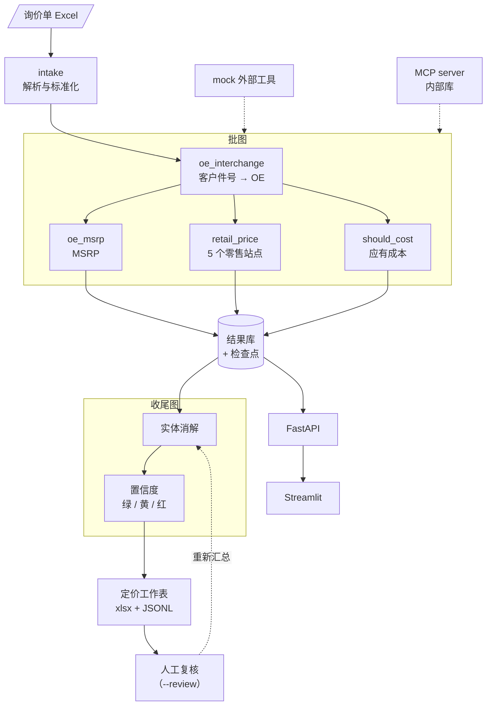

# RFQ-Agent

[English](README.md) | 简体中文

汽车售后零件询价（RFQ）的自动报价流水线，用 Python + LangGraph 实现。客户发来一份 Excel 询价单（几百到几千个客户件号），系统为每个件号找到 OE（原厂）号，查 OE 厂商指导价（MSRP）和零售价，估算应有成本（should-cost），最后输出一份按置信度着色的定价工作表，供定价团队决策。

目前这是一个**学习与交流用的项目**，关注多 agent 拆分、阶段契约、实体消解、分批容错、置信度分流和人工复核这些设计问题，并用可量化的评估结果检验置信度策略。后续计划发展为对接真实企业数据的版本；如果你对这个方向感兴趣、希望合作，欢迎通过 GitHub Issue 联系。

- 所有外部数据源（OEM 目录、互换查询、厂商价格页、5 个零售站点、产品规格页）都是 **mock**，数据由合成数据生成器产生，带 ground truth；品牌和车型均为虚构，不爬任何真实网站。
- 内部零件库是 SQLite，通过 MCP server 访问。
- `cost_model.yaml` 中的费率均为示意值，不代表任何真实关税或报价。

技术栈：Python 3.11+、uv、LangGraph、LangChain chat model（默认 DeepSeek，另支持 Anthropic、Qwen 和测试用的 FakeLLM）、官方 `mcp` SDK + `langchain-mcp-adapters`、Pydantic v2、SQLite、FastAPI、Streamlit、openpyxl、pytest。

## 快速开始

需要先装 [uv](https://docs.astral.sh/uv/)，Python 版本由 uv 按 `.python-version` 准备。下面三条命令用 fake 模式跑通整条流水线，不需要 API key，也不产生费用：

<!-- quickstart:begin -->
```bash
uv sync
uv run rfq data generate
RFQ_LLM_PROVIDER=fake uv run rfq run --input data/samples/rfq_sample_20.xlsx
```
<!-- quickstart:end -->

1. `uv sync`：创建 `.venv` 并安装依赖。
2. `rfq data generate`：生成 200 行的合成数据集 `data/generated/n200_s42/`（内部库 `internal.db`、各类模拟页面、ground truth），打印各难点的实际比例；同时写出 20 行样例 `data/samples/rfq_sample_20.xlsx`（与仓库中的文件逐字节相同）。
3. `rfq run`：对 20 行样例跑完整流水线。`RFQ_LLM_PROVIDER=fake` 让所有角色使用 FakeLLM：它按规则从页面文本抽取，结果确定、零成本，用来验证流程，不代表模型准确率。

第三条的输出（在全新 clone 中实际运行，路径缩写为相对路径）：

```text
LLM calls: oe_interchange (fake/fake) expected ~60, upper bound 300
LLM calls: oe_msrp (fake/fake) expected ~20, upper bound 60
LLM calls: retail_price (fake/fake) expected ~20, upper bound 60
LLM calls: should_cost (fake/fake) expected ~20, upper bound 60
LLM calls: judge (fake/fake) expected ~20, upper bound 60
rows=20 strategy=evidence_plus_judge
run_id=run-20261013T052139Z-cc51d4  (resume with: rfq run --resume run-20261013T052139Z-cc51d4)
batches: completed 1
rows 20: green 11, yellow 5, red 4
LLM usage: calls=101 errors=0 input_tokens=35890 output_tokens=7515 cost_usd=0.0
worksheet: data/runs/run_run-20261013T052139Z-cc51d4.xlsx
rows: data/runs/run_run-20261013T052139Z-cc51d4.jsonl
row correct 20/20 (by band: green 11/11, yellow 5/5, red 4/4)
```

产物在 `data/runs/`：

- `run_<run_id>.xlsx`：定价工作表。一行一个询价件号，按档位整行着色（绿 / 黄 / 红），MSRP、参考零售价、到岸成本三列并列作为参考价区间，另有置信度分数、需复核原因、各阶段 reasoning 摘要。第二个 sheet 是本次运行汇总。
- `run_<run_id>.jsonl`：每行一条完整结果（四路 agent 输出、证据、置信度信号）。
- 运行记录、四路结果与 LLM 调用写在结果库 `data/rfq.db` 中，API 和 Dashboard 从这里读取。

最后一行 `row correct` 是 fake 结论与样例 ground truth 的快速核对；完整评估见下文的 `rfq eval`。

## 架构



- 四个 subagent 各自是独立的 LangGraph 子图，有单独的 CLI 子命令和测试；LLM 只负责从带噪声的页面文本中抽取事实，选号、替代链、离群检测、选价、成本公式都由确定性代码完成。
- 批图每批 100 行（可配置），批之间顺序执行；每批内对 OE 解析结果并行 fan-out 三个价格 / 成本 agent，一批的结果在一个事务里写入结果库；检查点粒度是“一行一个 agent”，进程被杀后 `--resume` 只补跑没完成的部分。
- 实体消解和置信度放在收尾图里对全表做，因为多对一的共用 OE 组通常跨批。收尾完成后工作表即可下载；开了 `--review` 的运行再在已收尾的结果上复核红档行，每条决定后回到实体消解重新汇总。
- 置信度有三种可切换的策略（`evidence` / `evidence_plus_self` / `evidence_plus_judge`），默认 `evidence_plus_judge`，选择依据见[评估结果](#评估结果)。

详细的阶段契约和业务规则见 [RFQ-SPEC.md](RFQ-SPEC.md)。

## 配置

配置在 `config/` 下，API key 只放在 `.env`（已被 git 忽略）。

`config/settings.yaml` 各节：

| 节 | 管什么 | 常改的键 |
|---|---|---|
| `llm` | 默认 provider / 模型、温度、并发、单价（成本统计用）、按角色覆盖、各 provider 的 `base_url` 与 key 的环境变量名 | `provider`、`model`、`max_concurrency`、`pricing_per_million`、`roles.judge` |
| `pipeline` | 批大小、结构化输出重试次数、零售离群阈值、内外部重量一致的容差 | `batch_size`、`retail_outlier_threshold` |
| `confidence` | 置信度策略、档位阈值、自评与 judge 的参数、证据信号的权重与取值 | `strategy`、`bands`、`judge_band`、`evidence.weights` |
| `storage` | 结果库、检查点库、上传目录的路径，运行租约的时长 | `db_path`、`checkpoint_path` |
| `data` | 默认数据集目录（mock 工具和内部库从这里读） | `dataset_dir` |
| `tools` | mock 工具每次返回的条数、混入的干扰页数、故障注入（超时、空结果） | `max_decoys`、`faults` |

`config/cost_model.yaml` 是应有成本与到岸成本公式的费率（均为示意值），合成数据的 ground truth 用的是同一套参数。

`uv run rfq config show` 打印合并后的配置和每个角色实际用的 provider / 模型，以及对应的 API key 是否已设置（不打印 key 本身）。

环境变量：

| 变量 | 作用 |
|---|---|
| `RFQ_LLM_PROVIDER` | 设为 `fake` 时所有角色强制使用 FakeLLM |
| `DEEPSEEK_API_KEY` / `ANTHROPIC_API_KEY` / `DASHSCOPE_API_KEY` | DeepSeek / Anthropic / Qwen 的 API key（变量名由 `llm.providers.*.api_key_env` 指定） |
| `RFQ_CONFIG_DIR` | 换一个配置目录（默认 `config/`） |
| `RFQ_SKIP_DOTENV` | 设为 `1` 时不读项目根目录的 `.env`（测试用） |
| `RFQ_API_URL` | Dashboard 访问的 API 地址，默认 `http://127.0.0.1:8000` |

### 使用真实 LLM

默认配置是 DeepSeek（agent 用 `deepseek-flash`，judge 用 `deepseek-v4-pro`）。

1. `cp .env.example .env`，填入对应 provider 的 key。
2. 命令加 `--allow-real`。会调用 LLM 的命令（`rfq run`、`--resume`、`rerun-failed`、`rescore`、`rfq agent ...`、`rfq api serve`）在运行前都会按角色打印 provider / 模型和预计调用数；没加 `--allow-real` 时直接拒绝，不发出任何请求：

```text
$ uv run rfq run --input data/samples/rfq_sample_20.xlsx
LLM calls: oe_interchange (deepseek/deepseek-flash) expected ~60, upper bound 300
LLM calls: oe_msrp (deepseek/deepseek-flash) expected ~20, upper bound 60
LLM calls: retail_price (deepseek/deepseek-flash) expected ~20, upper bound 60
LLM calls: should_cost (deepseek/deepseek-flash) expected ~20, upper bound 60
LLM calls: judge (deepseek/deepseek-v4-pro) expected ~20, upper bound 60
rows=20 strategy=evidence_plus_judge
Real LLM provider for role 'oe_interchange' (deepseek), 'oe_msrp' (deepseek), 'retail_price' (deepseek), 'should_cost' (deepseek), 'judge' (deepseek); re-run with --allow-real to proceed.
```

每次调用的 token、成本和耗时都记在结果库的 `llm_calls` 表中，`rfq runs show` 与评估报告会汇总。

运行环境要求 SQLite ≥ 3.51.2（3.51.0 / 3.51.1 在多线程关闭连接时可能死锁，检测到时会给出警告）。

## 评估结果

以下数字全部来自用真实 LLM（agent 用 `deepseek-flash`）跑出、记录在 `docs/plans/` 中的实验，运行 id 和完整观察见各文件。fake 模式的评估数字只说明流程能跑通，没有参考意义。

### 三种置信度策略，200 行合成数据（[phase-10.md](docs/plans/phase-10.md)，2026-10-09）

先用 `evidence` 跑一次完整运行，再用 `rfq rescore` 在同一份 agent 结果上换另外两种策略，所以三者的差别只来自置信度策略。当时的 judge 规则：只审证据分 50–79 的行，同意时也加分。

| 策略 | LLM 调用 | 本运行成本 | 合计（含 agent） | 每千行 | 绿 / 黄 / 红 | 行正确 | 可直接使用 | ECE | AUROC |
|---|---|---|---|---|---|---|---|---|---|
| `evidence` | 864 | $0.453 | $0.453 | $2.27 | 115 / 49 / 36 | 100% | 82.0% | 0.209 | 1.000 |
| `evidence_plus_self` | 328 | $0.166 | $0.619 | $3.09 | 148 / 16 / 36 | 100% | 82.0% | 0.190 | 1.000 |
| `evidence_plus_judge` | 49 | $0.108 | $0.561 | $2.81 | 154 / 10 / 36 | 100% | 82.0% | 0.192 | 1.000 |

各阶段在这份数据上全对（OE、MSRP 准确率 100%，零售参考站点与离群检测 100%，到岸成本 MAPE 0.0% / 8.3%，后者是按设计用品类默认 cycle time 的 30 行）。没有错行可拦，AUROC = 1 是红档封顶规则（OE 为 multiple / not_found）决定的，**这次对比分不出策略**。

### 错误注入实验（[phase-10-inject.md](docs/plans/phase-10-inject.md)、[phase-10-llm-checks.md](docs/plans/phase-10-llm-checks.md)，2026-10-10 / 11）

在另一份 200 行数据（seed 43，难点比例提高）的真实运行上，用 `rfq eval inject` 把 40 行改成“看起来合理”的错误（OE 号换成相邻假号、MSRP 放大 15–35%、参考零售价换到另一个站点，各约 1/3），再在同一份结果上比较各策略能否把错行拦在绿档之外。

| 策略 | 规则 | 绿 / 黄 / 红 | 注入行被拦下 | 留在绿档的错行 | 注入 AUROC | 整体 AUROC | 绿档可直接使用 | 本运行成本 |
|---|---|---|---|---|---|---|---|---|
| `evidence` | – | 88 / 56 / 56 | 45% | 22 / 40 | 0.565 | 0.819 | 75.0% | $0 |
| `evidence_plus_self` | 旧 | 109 / 35 / 56 | 55% | 18 / 40 | 0.719 | 0.883 | 83.5% | $0.148 |
| `evidence_plus_self` | 新：加问 MSRP | 116 / 28 / 56 | 42.5% | 23 / 40 | 0.764 | 0.901 | 80.2% | $0.180 |
| `evidence_plus_judge` | 旧：只审 50–79，同意加分 | 128 / 5 / 67 | 30% | 28 / 40 | 0.661 | 0.859 | 78.1% | $0.128 |
| `evidence_plus_judge` | 新：审全部非红档行，只降分 | 72 / 44 / 84 | **85%** | **6 / 40** | **0.875** | **0.948** | **91.7%** | $0.330 |

“被拦下”= 注入行落在黄档或红档；注入 AUROC 衡量分数把注入行排在正常可用行之后的能力。

### 为什么默认用 `evidence_plus_judge`

- 只有新规则下的 judge 能大量拦下看起来合理的错误：40 行错行只有 6 行留在绿档（OE 2、MSRP 0、零售 4），13 行 MSRP 错全部压到红档。
- 它压到红档的 28 行全是注入行，没有误拦正常行；代价是 judge 调用从 56 次增到 144 次，200 行 $0.33，每千行约多 $1.65。
- 自评（`evidence_plus_self`）作为加分信号用处有限：加问 MSRP 后整体留在绿档的错行反而从 18 增到 23，两次采样波动较大。自评保留加问 MSRP，但没有改成只降分（同意时仍按权重加分）。

### 局限

- 数据是合成的，agent 在干净数据上几乎全对，错行是人工注入的；结论只说明“拦错”的能力，不代表真实询价单上的准确率。
- 只测了 DeepSeek 一家的模型，每组实验 200 行、40 行注入，样本量小。
- 档位阈值和证据权重没有按评估结果调整（曲线上的阈值由封顶规则决定，不是分数校准出来的）。

## 更多用法

以下命令都在快速开始之后、在同一个全新 clone 中用 fake 模式实际运行过；`RUN_ID` 换成自己的运行 id。可以先 `export RFQ_LLM_PROVIDER=fake`，省得每条都写。

### 评估：`rfq eval`

与 ground truth 对比，写 `reports/eval_<run_id>.md` 和两张图（可靠性图、覆盖率-准确率曲线）。不调用 LLM。

```text
$ RFQ_LLM_PROVIDER=fake uv run rfq eval --run run-20261013T052139Z-cc51d4
run run-20261013T052139Z-cc51d4 (evidence_plus_judge, 20 rows): row correct 100.0%, usable 80.0%, ECE 0.211, AUROC 1.000
bands: green 11 (usable 11, correct 11), yellow 5 (usable 5, correct 5), red 4 (usable 0, correct 4); red rows correct 100.0%
report: reports/eval_run-20261013T052139Z-cc51d4.md
```

ground truth 按询价单自动推断，也可以用 `--truth` 指定。

### 策略对比：`rfq rescore` + `rfq eval compare`

`rfq rescore` 复制一个已收尾运行的四路 agent 结果，只用另一种策略重做收尾（不重跑 agent），运行前打印准确的调用数：

```text
$ RFQ_LLM_PROVIDER=fake uv run rfq rescore run-20261013T052139Z-cc51d4 --strategy evidence_plus_self
LLM calls: self_eval (fake/fake) expected 32, upper bound 96
rows=20 strategy=evidence_plus_self (stage agents reused, not run)
re-scoring run-20261013T052139Z-cc51d4 with evidence_plus_self
run_id=run-20261013T052227Z-9d9d6c  (resume with: rfq run --resume run-20261013T052227Z-9d9d6c)
batches: completed 1
rows 20: green 15, yellow 1, red 4
LLM usage: calls=32 errors=0 input_tokens=16498 output_tokens=1744 cost_usd=0.0
```

各运行分别 `rfq eval --run` 之后：

```bash
RFQ_LLM_PROVIDER=fake uv run rfq eval compare --runs run-20261013T052224Z-7a6078 run-20261013T052227Z-9d9d6c run-20261013T052139Z-cc51d4
```

终端打印对比表（策略、各档行数、行正确率、可直接使用率、ECE、AUROC、目标准确率 95% 的阈值与覆盖率、调用数与成本等），并写出 `reports/compare_<时间>.md` 与叠加的两张图。

### 错误注入：`rfq eval inject`

复制一个运行并把部分行改成已知的错误，用 `evidence` 收尾（不调用 LLM）；之后可以对它 `rescore` 其他策略再评估。20 行样例只够注入几行：

```text
$ RFQ_LLM_PROVIDER=fake uv run rfq eval inject run-20261013T052139Z-cc51d4 --rows 6 --seed 7
injected 6 rows: oe 2, msrp 2, retail 2
run_id=run-20261013T052229Z-cb371a  (resume with: rfq run --resume run-20261013T052229Z-cb371a)
batches: completed 1
rows 20: green 11, yellow 5, red 4
LLM usage: calls=0 errors=0 input_tokens=0 output_tokens=0 cost_usd=n/a
row correct 14/20 (by band: green 6/11, yellow 4/5, red 4/4)
```

评估注入运行时多报一节注入结果（被拦下的比例、留在绿档的注入行、注入 AUROC）。fake 的 judge 总是同意，所以 fake 下看不出策略的差别。

### 人工复核：`rfq run --review`

收尾后逐个展示红档行的证据和结论，可以接受、改 OE 号、改价或拒绝；按 `q` 暂停，之后用 `rfq run --resume RUN_ID` 继续。复核前工作表已经写好。

```bash
RFQ_LLM_PROVIDER=fake uv run rfq run --input data/samples/rfq_sample_20.xlsx --review
```

### 续跑与重跑

- `rfq run --resume RUN_ID`：跳过已完成的批，从断点继续（进程被杀后也适用）。
- `rfq rerun-failed RUN_ID`：重跑失败的批和有行失败的行，然后重做收尾；没有可重跑的行时输出 `nothing to rerun`。
- `rfq runs show RUN_ID`：各批状态与执行次数、档位分布、LLM 调用数与成本。

### 单独运行一个 agent

四个 agent 都有自己的子命令（`oe-interchange`、`oe-msrp`、`retail-price`、`should-cost`），输出 JSONL 和 trace，并与 ground truth 做快速对比：

```text
$ RFQ_LLM_PROVIDER=fake uv run rfq agent oe-interchange --input data/samples/rfq_sample_20.xlsx --limit 3
rows=3 provider=fake model=fake
LLM calls: expected ~9, upper bound 45
run_id=oe_interchange-20261013T052251Z-5c2d01 wrote 3 rows (0 failed) to data/runs/oe_interchange_20261013T052251Z.jsonl
LLM usage: calls=6 errors=0 input_tokens=1197 output_tokens=268 cost_usd=0.0
trace: data/runs/oe_interchange_20261013T052251Z.trace.jsonl  (view with: rfq trace show data/runs/oe_interchange_20261013T052251Z.trace.jsonl --row 1)
**Summary:** OE correct 3/3 · not_found 1/1 · resolved 2/2 · chain correct 2/2 · our part correct 3/3 · failed rows 0
```

### API：`rfq api serve`

```bash
RFQ_LLM_PROVIDER=fake uv run rfq api serve          # http://127.0.0.1:8000，OpenAPI 文档在 /docs
```

上传询价单会在后台启动一个 worker 进程执行运行，返回 202：

```text
$ curl -s -F file=@data/samples/rfq_sample_20.xlsx -F review=false http://127.0.0.1:8000/runs
{"schema_version":"1.1","run_id":"run-20261013T052322Z-e02605", ... "status":"running","finished_at":null}
```

几秒后 `GET /runs/{run_id}` 的状态变为 `completed`，`summary` 中有各档行数、各阶段覆盖率、LLM 用量与耗时。其他接口：`GET /runs`、`GET /runs/{id}/rows?band=red`、`GET /runs/{id}/rows/{row_id}`、`POST /runs/{id}/rows/{row_id}/review`、`GET /runs/{id}/worksheet.xlsx`、`GET /runs/{id}/eval`、`POST /runs/{id}/resume`。配置为真实 provider 时，`rfq api serve` 需要加 `--allow-real`，否则会触发 LLM 调用的请求返回 409。

### Dashboard

API 启动后，另开一个终端：

```bash
uv run streamlit run dashboard/app.py
```

六个页面：上传与运行、运行总览、工作表（按档位着色）、行详情（替代链、各站点价格对比、成本瀑布图、置信度信号、各阶段 reasoning）、复核队列、评估（含策略对比与注入结果）。Dashboard 只通过 HTTP 调 API，不 import 后端代码；API 不在默认地址时设置 `RFQ_API_URL`。

### MCP server

```bash
uv run rfq mcp serve
```

以 stdio 启动内部库 MCP server（`lookup_our_part`、`get_part_spec`、`get_material_price`、`list_materials`、`get_cost_params`），可用 MCP Inspector 调试。agent 运行时会自己启动它，平时不需要手动运行。

### 生成更大的数据

```bash
uv run rfq data generate --n-parts 8000 --seed 42                # 写到 data/generated/n8000_s42/
uv run rfq data generate --seed 43 --ratio supersession=0.3      # 调整难点比例，写到 n200_s43/
```

调整比例时请换 seed 或用 `--out` 指定目录：输出目录默认只按行数和 seed 命名，200 行、seed 42 会覆盖默认数据集。用其他数据集跑时给 `rfq run` 加 `--dataset`：

```bash
RFQ_LLM_PROVIDER=fake uv run rfq run --input data/generated/n8000_s42/rfq_8000.xlsx --dataset data/generated/n8000_s42 --limit 20
```

## 开发

```bash
uv run pytest                                   # 全部在 fake 模式下运行，不调用真实 LLM
uv run ruff check src tests dashboard
uv run mypy src
uv run mypy --ignore-missing-imports dashboard
```

`uv run pytest` 当前 639 passed，约 4 分钟。其中 `tests/test_readme_quickstart.py` 把仓库复制到临时目录，执行 README 快速开始中的三条命令，检查退出码、产物，以及跑完后 git 工作区保持干净；同时检查中英文两版 README 的快速开始命令一致。

## 仓库导览

| 路径 | 内容 |
|---|---|
| [RFQ-SPEC.md](RFQ-SPEC.md) | 需求与业务规则（唯一来源） |
| [GLOSSARY.md](GLOSSARY.md) | 领域术语 |
| [docs/plans/](docs/plans/) | 每个 Phase 的决策记录、审查修复与真实 LLM 实验结果 |
| [docs/design-notes.md](docs/design-notes.md) | 设计说明（模板，待填写） |
| `config/` | `settings.yaml`、`cost_model.yaml` |
| `src/rfq_agent/` | `agents/` 四个 subagent、`orchestrator/` LangGraph 主图、`resolution/` 实体消解、`confidence/` 置信度策略、`llm/` LLM 工厂与 FakeLLM、`tools/` mock 外部工具、`mcp_server/` 内部库、`data_gen/` 合成数据、`store/` 结果库、`output/` Excel、`api/` FastAPI、`eval/` 评估、`cli/` 命令行 |
| `dashboard/` | Streamlit 前端（只调 API） |
| `data/samples/` | 入库的 20 行样例询价单 |
| `tests/` | pytest |

## 许可证

[MIT](LICENSE)
